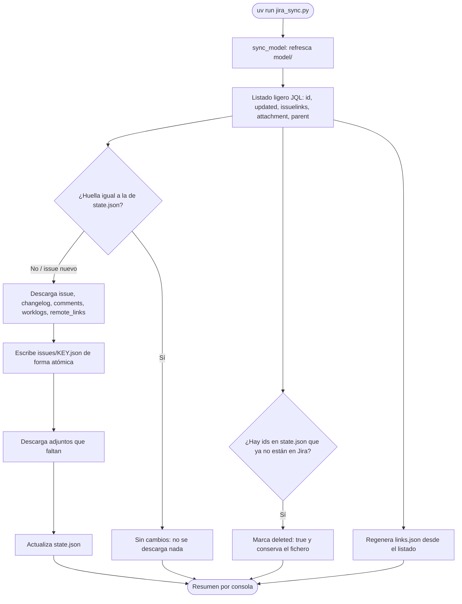
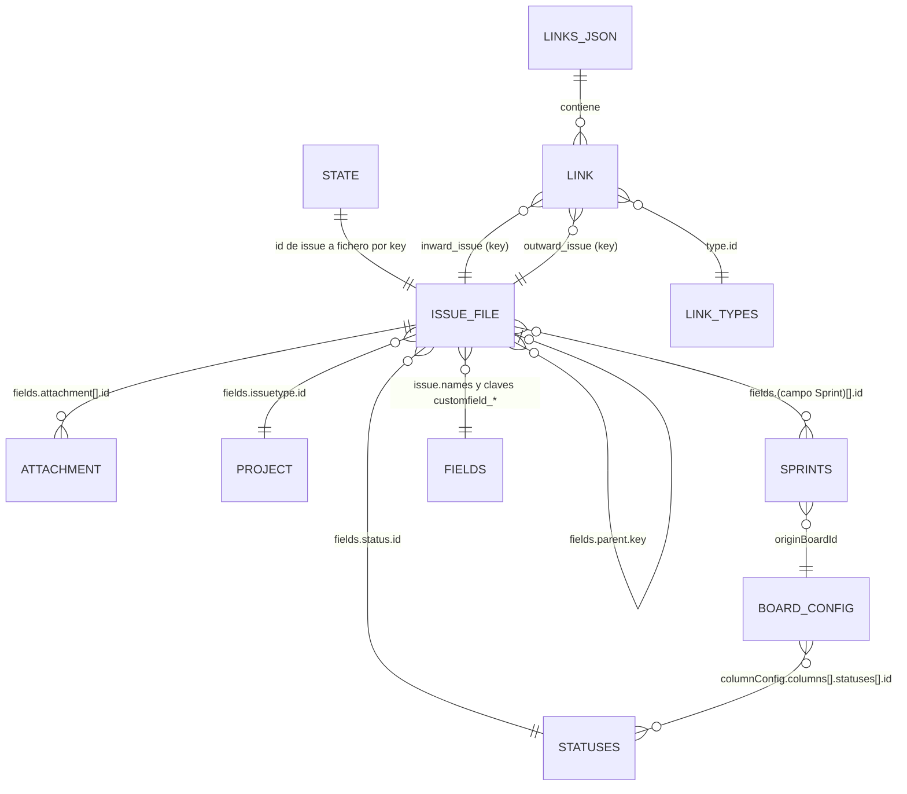

# Jira Project Sync

[English](README.md) | **Español**

Herramienta de volcado incremental de un proyecto de Jira Cloud. Conserva el modelo de Jira, las relaciones entre issues y sus tipos, y solo descarga lo que es nuevo o ha cambiado desde la última ejecución.

El resultado es un conjunto de ficheros JSON en disco, sin base de datos. Este documento describe cómo se genera, qué contiene cada fichero y cómo se relacionan, para que una persona o un agente de código pueda consultarlos sin necesidad de leer el script.

## Requisitos

- [uv](https://docs.astral.sh/uv/). El script declara sus dependencias (httpx) en la cabecera y `uv` las instala solo.
- Un API token de Atlassian: se genera en [la página de tokens de Atlassian](https://id.atlassian.com/manage-api-tokens).

## Configuración

Copia `.env.example` a `.env` y rellena los valores. Las variables de entorno tienen prioridad sobre `.env`.

| Variable         | Obligatoria | Por defecto | Descripción                             |
| :--------------- | :---------: | :---------- | :-------------------------------------- |
| `JIRA_URL`       |     Sí      | —           | URL de la instancia de Jira Cloud       |
| `JIRA_EMAIL`     |     Sí      | —           | Email de la cuenta                      |
| `JIRA_API_TOKEN` |     Sí      | —           | API token                               |
| `JIRA_PROJECT`   |     Sí      | —           | Clave del proyecto (por ejemplo `PROJ`) |
| `OUTPUT_DIR`     |     No      | `./backup`  | Carpeta de destino                      |
| `CONCURRENCY`    |     No      | `5`         | Número de peticiones en paralelo        |

## Uso

```bash
uv run jira_sync.py            # sincronización incremental
uv run jira_sync.py --full     # ignora el estado local y vuelve a descargar todo
uv run jira_sync.py --env ruta/al/.env
```

Al terminar muestra un resumen: issues nuevos, actualizados, sin cambios, borrados en Jira y adjuntos descargados.

## Arquitectura

Todo el código está en un único script, `jira_sync.py`, con estas piezas:

| Pieza                              | Responsabilidad                                                                                                             |
| :--------------------------------- | :-------------------------------------------------------------------------------------------------------------------------- |
| `load_config`                      | Lee `.env` (parser propio, sin dependencias) y las variables de entorno                                                     |
| `JiraClient`                       | Cliente httpx asíncrono con autenticación básica (email y token), paginación, descarga de ficheros y reintentos             |
| `sync_model`                       | Descarga el modelo de Jira (`model/`)                                                                                       |
| `sync_issues`                      | Sincronización incremental de issues, adjuntos, `state.json` y `links.json`                                                 |
| `fingerprint` y `build_link_graph` | Huella de cambios por issue y construcción del grafo de relaciones                                                          |
| `write_if_changed`                 | Escritura atómica (fichero temporal y `os.replace`) que solo toca el disco si el contenido cambia, con JSON ordenado y fijo |

Comportamiento de red:

- Autenticación básica con `JIRA_EMAIL` y `JIRA_API_TOKEN`.
- Un semáforo limita las peticiones simultáneas a `CONCURRENCY`.
- Se reintenta hasta 5 veces ante los códigos 429, 500, 502, 503 y 504 y ante errores de transporte. La espera es el valor de `Retry-After` o 2 elevado al número de intento, en segundos.
- Las listas largas se paginan de 100 en 100.
- Los adjuntos se descargan en streaming a un fichero `.part` que se renombra al terminar.



### Endpoints de Jira utilizados

| Destino                          | _Endpoint_                                                                                            |
| :------------------------------- | :---------------------------------------------------------------------------------------------------- |
| Listado de issues                | `GET /rest/api/3/search/jql` (JQL `project = <KEY> ORDER BY key ASC`, paginación con `nextPageToken`) |
| Issue                            | `GET /rest/api/3/issue/{id}?fields=*all&expand=renderedFields,names`                                  |
| `changelog`                      | `GET /rest/api/3/issue/{id}/changelog`                                                                |
| `comments`                       | `GET /rest/api/3/issue/{id}/comment`                                                                  |
| `worklogs`                       | `GET /rest/api/3/issue/{id}/worklog`                                                                  |
| `remote_links`                   | `GET /rest/api/3/issue/{id}/remotelink`                                                               |
| `model/project.json`             | `GET /rest/api/3/project/{key}?expand=description,lead,issueTypes`                                    |
| `model/statuses.json`            | `GET /rest/api/3/project/{key}/statuses`                                                              |
| `model/components.json`          | `GET /rest/api/3/project/{key}/components`                                                            |
| `model/versions.json`            | `GET /rest/api/3/project/{key}/versions`                                                              |
| `model/fields.json`              | `GET /rest/api/3/field`                                                                               |
| `model/link_types.json`          | `GET /rest/api/3/issueLinkType`                                                                       |
| `model/priorities.json`          | `GET /rest/api/3/priority`                                                                            |
| `model/boards.json`              | `GET /rest/agile/1.0/board?projectKeyOrId=<KEY>`                                                      |
| `model/board_<id>_configuration` | `GET /rest/agile/1.0/board/{id}/configuration`                                                        |
| `model/board_<id>_sprints`       | `GET /rest/agile/1.0/board/{id}/sprint` (un tablero sin _sprints_ responde 400 y se guarda `[]`)      |

## Qué se guarda

Todo queda en `backup/<PROYECTO>/`:

```text
backup/PROJ/
├── state.json                         # control de la sincronización
├── links.json                         # grafo de relaciones entre issues
├── issues/
│   └── PROJ-12.json                   # un fichero por issue
├── attachments/
│   └── PROJ-12/
│       └── 10042_diagrama.png         # <id del adjunto>_<nombre original>
└── model/
    ├── project.json
    ├── statuses.json
    ├── fields.json
    ├── link_types.json
    ├── priorities.json
    ├── components.json
    ├── versions.json
    ├── boards.json
    ├── board_1_configuration.json
    └── board_1_sprints.json
```

| Ruta                                  | Contenido                                                                                            |
| :------------------------------------ | :--------------------------------------------------------------------------------------------------- |
| `issues/PROJ-n.json`                  | Issue con todos sus campos, changelog completo, comentarios, worklogs y enlaces remotos              |
| `links.json`                          | Enlaces entre issues con su tipo (`Blocks`, `Relates`...) y jerarquía padre/hijo (epics y subtareas) |
| `model/project.json`                  | Definición del proyecto, con sus tipos de issue                                                      |
| `model/statuses.json`                 | Estados por tipo de issue                                                                            |
| `model/fields.json`                   | Campos, incluidos los personalizados                                                                 |
| `model/link_types.json`               | Tipos de enlace disponibles                                                                          |
| `model/priorities.json`               | Prioridades                                                                                          |
| `model/components.json`               | Componentes del proyecto                                                                             |
| `model/versions.json`                 | Versiones del proyecto                                                                               |
| `model/boards.json`                   | Boards del proyecto                                                                                  |
| `model/board_<id>_configuration.json` | Configuración de cada board                                                                          |
| `model/board_<id>_sprints.json`       | Sprints de cada board                                                                                |
| `attachments/<issue>/<id>_<nombre>`   | Adjuntos                                                                                             |
| `state.json`                          | Estado de sincronización (no editar a mano)                                                          |

Los ficheros JSON se escriben con claves ordenadas y sangría fija, de modo que son comparables con `diff` o con git. El contenido es el que devuelve la API de Jira sin transformar, salvo `state.json`, `links.json` y la envoltura de cada issue, que genera el script.

## Cómo se relacionan los datos



Las entidades del diagrama son ficheros o partes de ellos:

| Entidad        | Fichero                                                         |
| :------------- | :-------------------------------------------------------------- |
| `STATE`        | `state.json`                                                    |
| `ISSUE_FILE`   | `issues/<KEY>.json`                                             |
| `ATTACHMENT`   | `attachments/<KEY>/<id>_<nombre>`                               |
| `LINKS_JSON`   | `links.json`                                                    |
| `LINK`         | Elemento de `links.json` → `links`                              |
| `LINK_TYPES`   | `model/link_types.json`                                         |
| `STATUSES`     | `model/statuses.json`                                           |
| `PROJECT`      | `model/project.json` (los tipos de issue están en `issueTypes`) |
| `SPRINTS`      | `model/board_<id>_sprints.json`                                 |
| `FIELDS`       | `model/fields.json`                                             |
| `BOARD_CONFIG` | `model/board_<id>_configuration.json`                           |

### Identificadores y claves de unión

| Concepto              | Clave de unión                   | Notas                                                                                                                                                                    |
| :-------------------- | :------------------------------- | :----------------------------------------------------------------------------------------------------------------------------------------------------------------------- |
| Identidad de un issue | `id` (cadena numérica)           | Estable. La clave (`PROJ-12`) puede cambiar si el issue se mueve de proyecto                                                                                             |
| Nombre de fichero     | `key` del issue                  | `issues/<key>.json`. Si la clave cambia, el script renombra el fichero                                                                                                   |
| `state.json`          | `id` del issue                   | Cada entrada apunta a la `key` actual                                                                                                                                    |
| Enlaces y jerarquía   | `key`                            | `links.json` referencia issues por clave, no por id                                                                                                                      |
| Tipo de enlace        | `type.id`                        | Se resuelve en `model/link_types.json`                                                                                                                                   |
| Estado de un issue    | `fields.status.id`               | Se resuelve en `model/statuses.json`, agrupado por tipo de issue                                                                                                         |
| Tipo de issue         | `fields.issuetype.id`            | Se resuelve en `model/project.json` → `issueTypes`. `hierarchyLevel` ordena los niveles: Epic 1, Historia 0, Subtask -1                                                  |
| _Sprint_ de un issue  | `fields.<campo Sprint>[].id`     | Se resuelve en `model/board_<id>_sprints.json`. El identificador del campo se localiza en `model/fields.json` (`schema.custom` = `com.pyxis.greenhopper.jira:gh-sprint`) |
| Nombre de un campo    | `customfield_*` o nombre clásico | `issue.names` (por issue) y `model/fields.json` (global) traducen el identificador al nombre visible                                                                     |
| Adjunto               | `fields.attachment[].id`         | El fichero está en `attachments/<key>/<id>_<nombre>`                                                                                                                     |

## Formato de cada fichero

### `issues/<KEY>.json`

Es una envoltura generada por el script con cinco claves:

| Clave          | Tipo   | Contenido                                                                                                               |
| :------------- | :----- | :---------------------------------------------------------------------------------------------------------------------- |
| `issue`        | objeto | Respuesta de `GET /issue/{id}` con `fields=*all` y `expand=renderedFields,names`                                        |
| `changelog`    | lista  | Historial de cambios completo, del más antiguo al más reciente. Cada elemento tiene `id`, `author`, `created` e `items` |
| `comments`     | lista  | Comentarios completos (`id`, `author`, `body`, `created`, `updated`...)                                                 |
| `worklogs`     | lista  | Registros de tiempo                                                                                                     |
| `remote_links` | lista  | Enlaces a recursos externos (páginas de Confluence, URLs...)                                                            |

Dentro de `issue`:

- `id`, `key` y `self` identifican el issue.
- `fields` contiene todos los campos. Los más útiles son `summary`, `description`, `status`, `issuetype`, `priority`, `assignee`, `reporter`, `created`, `updated`, `labels`, `components`, `fixVersions`, `parent`, `subtasks`, `issuelinks` y `attachment`.
- `names` traduce el identificador de cada campo a su nombre visible, por ejemplo `customfield_10010` a Sprint. El número de un campo personalizado varía entre instancias.
- `renderedFields` repite los campos de texto enriquecido como HTML.

Ejemplos de campos personalizados de una instancia real (los identificadores varían entre instancias; búscalos por nombre o por `schema` en `model/fields.json`):

| Campo               | Nombre visible | Contenido                                                                                         |
| :------------------ | :------------- | :------------------------------------------------------------------------------------------------ |
| `customfield_10010` | Sprint         | Lista de objetos con `id`, `name`, `state`, `boardId`, `startDate`, `endDate` y `goal`            |
| `customfield_10011` | Clasificación  | Posición del issue en el orden del backlog (valor con formato LexoRank, por ejemplo `0\|hzzzzz:`) |
| `customfield_10000` | Desarrollo     | Información del panel de desarrollo. En este proyecto está vacío                                  |
| `customfield_10017` | Flagged        | Marca de impedimento                                                                              |

Trampas a tener en cuenta:

- **Texto enriquecido.** `description` y el `body` de cada comentario están en formato ADF (Atlassian Document Format), un árbol JSON con `type` y `content`. El HTML equivalente de la descripción está en `renderedFields.description`.
- **Comentarios y _worklogs_.** `issue.fields.comment` solo trae contadores (`total`) y `issue.fields.worklog` solo una primera página. Los datos completos están en las claves de primer nivel `comments` y `worklogs`.
- **Datos incrustados.** `fields.parent`, `fields.subtasks` y `fields.issuelinks[]` incluyen un resumen del issue relacionado (título, estado, prioridad, tipo) tal como estaba al descargar. Puede estar desactualizado: la fuente fiable es el fichero del otro issue.
- **Fechas.** Tienen el formato de Jira, por ejemplo `2026-10-26T05:56:05.043+0100`.
- **URLs.** Los campos `self`, `iconUrl`, `avatarUrls` y `content` (adjuntos) apuntan a la instancia de Jira y dejarán de funcionar cuando se dé de baja.

### `links.json`

Grafo de relaciones entre issues, regenerado en cada ejecución a partir del listado actual de Jira. Tiene dos claves:

```json
{
  "links": [
    {
      "id": "10100",
      "inward_issue": "PROJ-12",
      "outward_issue": "PROJ-13",
      "type": {
        "id": "10000",
        "name": "Blocks",
        "inward": "is blocked by",
        "outward": "blocks"
      }
    }
  ],
  "hierarchy": [{ "child": "PROJ-10", "parent": "PROJ-1" }]
}
```

- `links`: un elemento por enlace, sin duplicados (el mismo enlace aparece en los dos issues, pero aquí se deduplica por `id`). Se lee como `<inward_issue> <type.outward> <outward_issue>`; en el ejemplo, PROJ-12 blocks PROJ-13. Leído al revés, `<outward_issue> <type.inward> <inward_issue>`: PROJ-13 is blocked by PROJ-12.
- `hierarchy`: relaciones padre/hijo según `fields.parent`. Cubre epic → historia y historia → subtarea. Los epics no tienen padre.

### `state.json`

Diccionario que usa el script para decidir qué descargar. No hace falta leerlo para consumir los datos, y no se debe editar.

```json
{
  "10042": {
    "key": "PROJ-1",
    "fingerprint": "0123456789abcdef0123456789abcdef01234567"
  }
}
```

- La clave es el `id` del issue.
- `key` es la clave actual y define el nombre del fichero en `issues/`.
- `fingerprint` es la huella de la última versión descargada.
- `deleted: true` aparece cuando el issue ya no existe en Jira. Su fichero se conserva.

### Ficheros de `model/`

| Fichero                         | Forma                       | Contenido                                                                                                                 |
| :------------------------------ | :-------------------------- | :------------------------------------------------------------------------------------------------------------------------ |
| `project.json`                  | objeto                      | Proyecto: `id`, `key`, `name`, `lead`, `style`, `simplified` (true en proyectos gestionados por el equipo) e `issueTypes` |
| `statuses.json`                 | lista                       | Un elemento por tipo de issue, con la lista de sus estados (`id`, `name`, `statusCategory`)                               |
| `fields.json`                   | lista, ordenada por `id`    | Todos los campos de la instancia, también los de otros proyectos, con `id`, `name`, `custom` y `schema`                   |
| `link_types.json`               | objeto con `issueLinkTypes` | Tipos de enlace de toda la instancia: `id`, `name`, `inward`, `outward`                                                   |
| `priorities.json`               | lista                       | Prioridades de la instancia                                                                                               |
| `components.json`               | lista                       | Componentes del proyecto (puede estar vacía)                                                                              |
| `versions.json`                 | lista                       | Versiones del proyecto                                                                                                    |
| `boards.json`                   | lista                       | Tableros del proyecto                                                                                                     |
| `board_<id>_configuration.json` | objeto                      | Columnas del tablero (`columnConfig.columns`, cada una con los estados que agrupa), `estimation`, `ranking` y `filter`    |
| `board_<id>_sprints.json`       | lista                       | _Sprints_ del tablero: `id`, `name`, `state`, `startDate`, `endDate`, `goal`, `originBoardId`                             |

## Cómo evita trabajo innecesario

1. Pide a Jira un listado ligero de todas las claves con `updated`, enlaces, adjuntos y padre.
2. Calcula una huella por issue y la compara con la de `state.json`. Si coincide, no hace nada más con ese issue.
3. Descarga el issue completo solo si es nuevo o su huella ha cambiado. Los enlaces y adjuntos entran en la huella por si Jira no actualiza `updated` en los dos extremos de un enlace.
4. Descarga solo los adjuntos que faltan, comparando por id y tamaño.
5. Si un issue desaparece de Jira, lo marca como borrado en `state.json` y conserva su fichero local.
6. Si el issue cambia de clave (movido de proyecto), renombra su fichero. La identidad de un issue es su id, no su clave.
7. Los ficheros de `model/` se reescriben solo si su contenido cambia.

El estado se guarda tras cada issue, así que una ejecución interrumpida continúa donde se quedó.

La huella es el SHA-1 de `updated`, los identificadores de enlace ordenados, los identificadores de adjunto ordenados y la clave del padre. Una edición, un comentario nuevo o un cambio de enlace, adjunto o padre producen una huella distinta.

Si falla la descarga de algún issue, el resto termina y se guarda igualmente; el error se relanza al final y la siguiente ejecución solo repite los que faltan.

## Guía para operar con los datos

Convenciones:

- La descarga es de solo lectura respecto a Jira: el script no escribe nunca en Jira.
- Para consultar, lee los ficheros directamente. Para actualizar, vuelve a ejecutar el script; no edites `backup/` a mano, porque `state.json` dejaría de reflejar su contenido.
- Un issue borrado en Jira sigue en `issues/`. Para listar solo los vigentes, descarta los ids con `deleted: true` en `state.json`.
- La copia contiene datos personales (nombres, `accountId`, comentarios) y adjuntos. `backup/` está en `.gitignore`; no la publiques.

Ejemplos en Python (solo biblioteca estándar), ejecutados contra una descarga real:

```python
import json
from pathlib import Path

root = Path("backup/PROJ")
load = lambda path: json.loads(path.read_text(encoding="utf-8"))

# Todos los issues, indexados por clave
bundles = {p.stem: load(p) for p in sorted((root / "issues").glob("*.json"))}

# Solo los issues vigentes (excluye los borrados en Jira)
state = load(root / "state.json")
current = {v["key"] for v in state.values() if not v.get("deleted")}

# Enlaces tipados: "<inward_issue> <type.outward> <outward_issue>"
graph = load(root / "links.json")
for link in graph["links"]:
    print(link["inward_issue"], link["type"]["outward"], link["outward_issue"])

# Hijos de un epic
epic_key = "PROJ-1"
children = [h["child"] for h in graph["hierarchy"] if h["parent"] == epic_key]

# Identificador del campo Sprint (varía entre instancias): se localiza por su schema
fields = load(root / "model" / "fields.json")
sprint_field = next(
    f["id"]
    for f in fields
    if f.get("schema", {}).get("custom") == "com.pyxis.greenhopper.jira:gh-sprint"
)

# Issues por _sprint_
by_sprint = {}
for key, bundle in bundles.items():
    for sprint in bundle["issue"]["fields"].get(sprint_field) or []:
        by_sprint.setdefault(sprint["name"], []).append(key)

# Nombre visible de cualquier campo
names = {f["id"]: f["name"] for f in fields}
print(names[sprint_field])  # Sprint


# Texto plano de un documento ADF (descripción o comentario)
def adf_text(node):
    if node is None:
        return ""
    if node.get("type") == "text":
        return node["text"]
    return "".join(adf_text(child) for child in node.get("content", []))


print(adf_text(bundles["PROJ-12"]["issue"]["fields"]["description"]))
```

Al abrir los ficheros desde Python en Windows, pasa siempre `encoding="utf-8"`: el contenido está en UTF-8 y la codificación por defecto de la consola puede fallar con ciertos caracteres.

## Qué no se descarga

- Usuarios de la instancia y miembros de roles (solo aparecen los usuarios referenciados dentro de los issues).
- Flujos de trabajo, reglas de automatización, paneles y filtros guardados.
- Configuración de permisos y de seguridad de issues.
- Contenido de las páginas de Confluence enlazadas (solo el enlace, en `remote_links`).
- Imágenes de avatar e iconos (solo sus URL).

## Tests

Los tests usan un Jira simulado y no necesitan credenciales:

```bash
uv run --with httpx python -m unittest discover -s tests -v
```

## Limitaciones

- Solo es una herramienta de volcado: no restaura datos en Jira.
- Los comentarios, worklogs y changelog se descargan completos cada vez que cambia el issue.
- La descarga se ha verificado contra un proyecto real de Jira Cloud gestionado por el equipo (_team-managed_) con 187 issues. Los adjuntos, los worklogs y los enlaces remotos solo se han probado con el Jira simulado, porque ese proyecto no tiene ninguno.

## Licencia

[MIT](LICENSE)
