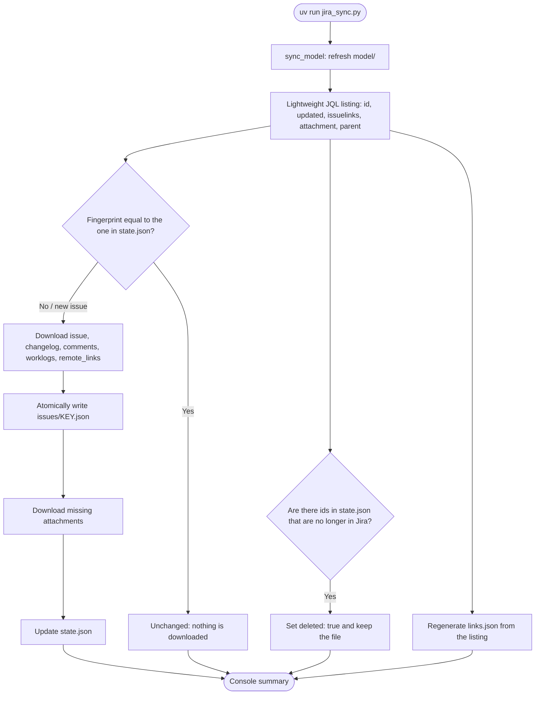
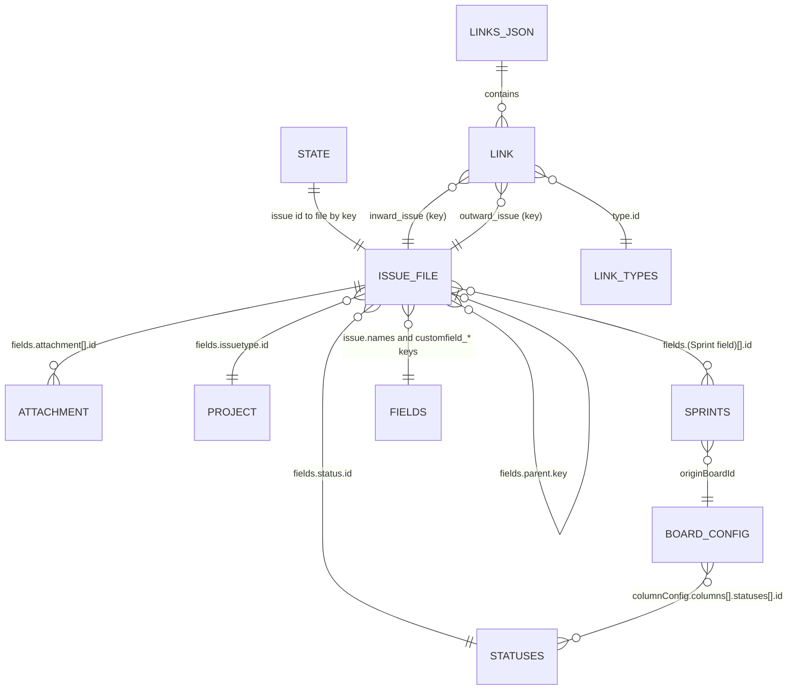

# Jira Project Sync

**English** | [Español](README-es.md)

Incremental dump tool for a Jira Cloud project. It keeps the Jira model, the relationships between issues and their types, and only downloads what is new or has changed since the last run.

The result is a set of JSON files on disk, with no database. This document describes how the data is produced, what each file contains and how the files relate to each other, so that a person or a coding agent can query them without reading the script.

## Requirements

- [uv](https://docs.astral.sh/uv/). The script declares its dependencies (httpx) in its header and `uv` installs them automatically.
- An Atlassian API token, which you can generate on [the Atlassian API tokens page](https://id.atlassian.com/manage-api-tokens).

## Configuration

Copy `.env.example` to `.env` and fill in the values. Environment variables take precedence over `.env`.

| Variable         | Required | Default    | Description                      |
| :--------------- | :------: | :--------- | :------------------------------- |
| `JIRA_URL`       |   Yes    | —          | URL of the Jira Cloud instance   |
| `JIRA_EMAIL`     |   Yes    | —          | Account email                    |
| `JIRA_API_TOKEN` |   Yes    | —          | API token                        |
| `JIRA_PROJECT`   |   Yes    | —          | Project key (for example `PROJ`) |
| `OUTPUT_DIR`     |    No    | `./backup` | Destination folder               |
| `CONCURRENCY`    |    No    | `5`        | Number of parallel requests      |

## Usage

```bash
uv run jira_sync.py            # incremental sync
uv run jira_sync.py --full     # ignore the local state and download everything again
uv run jira_sync.py --env path/to/.env
```

When it finishes it prints a summary: new issues, updated issues, unchanged issues, issues deleted in Jira and attachments downloaded.

## Architecture

All the code lives in a single script, `jira_sync.py`, made of these pieces:

| Piece                                | Responsibility                                                                                                        |
| :----------------------------------- | :-------------------------------------------------------------------------------------------------------------------- |
| `load_config`                        | Reads `.env` (own parser, no dependencies) and the environment variables                                              |
| `JiraClient`                         | Asynchronous httpx client with basic authentication (email and token), pagination, file download and retries          |
| `sync_model`                         | Downloads the Jira model (`model/`)                                                                                   |
| `sync_issues`                        | Incremental sync of issues, attachments, `state.json` and `links.json`                                                |
| `fingerprint` and `build_link_graph` | Per-issue change fingerprint and construction of the relationship graph                                               |
| `write_if_changed`                   | Atomic write (temporary file plus `os.replace`) that only touches the disk when the content changes, with sorted JSON |

Network behavior:

- Basic authentication with `JIRA_EMAIL` and `JIRA_API_TOKEN`.
- A semaphore limits simultaneous requests to `CONCURRENCY`.
- Requests are retried up to 5 times on status codes 429, 500, 502, 503 and 504 and on transport errors. The wait is the `Retry-After` value, or 2 raised to the attempt number, in seconds.
- Long lists are paginated 100 items at a time.
- Attachments are streamed to a `.part` file that is renamed when the download finishes.



### Jira endpoints used

| Target                           | Endpoint                                                                                               |
| :------------------------------- | :----------------------------------------------------------------------------------------------------- |
| Issue listing                    | `GET /rest/api/3/search/jql` (JQL `project = <KEY> ORDER BY key ASC`, pagination with `nextPageToken`) |
| Issue                            | `GET /rest/api/3/issue/{id}?fields=*all&expand=renderedFields,names`                                   |
| `changelog`                      | `GET /rest/api/3/issue/{id}/changelog`                                                                 |
| `comments`                       | `GET /rest/api/3/issue/{id}/comment`                                                                   |
| `worklogs`                       | `GET /rest/api/3/issue/{id}/worklog`                                                                   |
| `remote_links`                   | `GET /rest/api/3/issue/{id}/remotelink`                                                                |
| `model/project.json`             | `GET /rest/api/3/project/{key}?expand=description,lead,issueTypes`                                     |
| `model/statuses.json`            | `GET /rest/api/3/project/{key}/statuses`                                                               |
| `model/components.json`          | `GET /rest/api/3/project/{key}/components`                                                             |
| `model/versions.json`            | `GET /rest/api/3/project/{key}/versions`                                                               |
| `model/fields.json`              | `GET /rest/api/3/field`                                                                                |
| `model/link_types.json`          | `GET /rest/api/3/issueLinkType`                                                                        |
| `model/priorities.json`          | `GET /rest/api/3/priority`                                                                             |
| `model/boards.json`              | `GET /rest/agile/1.0/board?projectKeyOrId=<KEY>`                                                       |
| `model/board_<id>_configuration` | `GET /rest/agile/1.0/board/{id}/configuration`                                                         |
| `model/board_<id>_sprints`       | `GET /rest/agile/1.0/board/{id}/sprint` (a board without sprints answers 400 and `[]` is stored)       |

## What is stored

Everything ends up in `backup/<PROJECT>/`:

```text
backup/PROJ/
├── state.json                         # sync control
├── links.json                         # relationship graph between issues
├── issues/
│   └── PROJ-12.json                   # one file per issue
├── attachments/
│   └── PROJ-12/
│       └── 10042_diagram.png          # <attachment id>_<original name>
└── model/
    ├── project.json
    ├── statuses.json
    ├── fields.json
    ├── link_types.json
    ├── priorities.json
    ├── components.json
    ├── versions.json
    ├── boards.json
    ├── board_1_configuration.json
    └── board_1_sprints.json
```

| Path                                  | Content                                                                                  |
| :------------------------------------ | :--------------------------------------------------------------------------------------- |
| `issues/PROJ-n.json`                  | Issue with all its fields, full changelog, comments, worklogs and remote links           |
| `links.json`                          | Links between issues with their type (`Blocks`, `Relates`...) and parent/child hierarchy |
| `model/project.json`                  | Project definition, including its issue types                                            |
| `model/statuses.json`                 | Statuses per issue type                                                                  |
| `model/fields.json`                   | Fields, including custom fields                                                          |
| `model/link_types.json`               | Available link types                                                                     |
| `model/priorities.json`               | Priorities                                                                               |
| `model/components.json`               | Project components                                                                       |
| `model/versions.json`                 | Project versions                                                                         |
| `model/boards.json`                   | Project boards                                                                           |
| `model/board_<id>_configuration.json` | Configuration of each board                                                              |
| `model/board_<id>_sprints.json`       | Sprints of each board                                                                    |
| `attachments/<issue>/<id>_<name>`     | Attachments                                                                              |
| `state.json`                          | Sync state (do not edit by hand)                                                         |

JSON files are written with sorted keys and fixed indentation, so they can be compared with `diff` or git. The content is what the Jira API returns without transformation, except `state.json`, `links.json` and the wrapper of each issue, which the script generates.

## How the data relates



The entities in the diagram are files or parts of files:

| Entity         | File                                                      |
| :------------- | :-------------------------------------------------------- |
| `STATE`        | `state.json`                                              |
| `ISSUE_FILE`   | `issues/<KEY>.json`                                       |
| `ATTACHMENT`   | `attachments/<KEY>/<id>_<name>`                           |
| `LINKS_JSON`   | `links.json`                                              |
| `LINK`         | Element of `links.json` → `links`                         |
| `LINK_TYPES`   | `model/link_types.json`                                   |
| `STATUSES`     | `model/statuses.json`                                     |
| `PROJECT`      | `model/project.json` (issue types are under `issueTypes`) |
| `SPRINTS`      | `model/board_<id>_sprints.json`                           |
| `FIELDS`       | `model/fields.json`                                       |
| `BOARD_CONFIG` | `model/board_<id>_configuration.json`                     |

### Identifiers and join keys

| Concept              | Join key                        | Notes                                                                                                                                                |
| :------------------- | :------------------------------ | :--------------------------------------------------------------------------------------------------------------------------------------------------- |
| Identity of an issue | `id` (numeric string)           | Stable. The key (`PROJ-12`) can change if the issue is moved to another project                                                                      |
| File name            | `key` of the issue              | `issues/<key>.json`. If the key changes, the script renames the file                                                                                 |
| `state.json`         | `id` of the issue               | Each entry points to the current `key`                                                                                                               |
| Links and hierarchy  | `key`                           | `links.json` references issues by key, not by id                                                                                                     |
| Link type            | `type.id`                       | Resolved in `model/link_types.json`                                                                                                                  |
| Status of an issue   | `fields.status.id`              | Resolved in `model/statuses.json`, grouped by issue type                                                                                             |
| Issue type           | `fields.issuetype.id`           | Resolved in `model/project.json` → `issueTypes`. `hierarchyLevel` orders the levels: Epic 1, Story 0, Subtask -1                                     |
| Sprint of an issue   | `fields.<Sprint field>[].id`    | Resolved in `model/board_<id>_sprints.json`. The field id is found in `model/fields.json` (`schema.custom` = `com.pyxis.greenhopper.jira:gh-sprint`) |
| Name of a field      | `customfield_*` or classic name | `issue.names` (per issue) and `model/fields.json` (global) translate the identifier into the visible name                                            |
| Attachment           | `fields.attachment[].id`        | The file is in `attachments/<key>/<id>_<name>`                                                                                                       |

## Format of each file

### `issues/<KEY>.json`

A wrapper generated by the script with five keys:

| Key            | Type   | Content                                                                                            |
| :------------- | :----- | :------------------------------------------------------------------------------------------------- |
| `issue`        | object | Response of `GET /issue/{id}` with `fields=*all` and `expand=renderedFields,names`                 |
| `changelog`    | list   | Full change history, from oldest to newest. Each element has `id`, `author`, `created` and `items` |
| `comments`     | list   | Full comments (`id`, `author`, `body`, `created`, `updated`...)                                    |
| `worklogs`     | list   | Time tracking entries                                                                              |
| `remote_links` | list   | Links to external resources (Confluence pages, URLs...)                                            |

Inside `issue`:

- `id`, `key` and `self` identify the issue.
- `fields` contains all the fields. The most useful ones are `summary`, `description`, `status`, `issuetype`, `priority`, `assignee`, `reporter`, `created`, `updated`, `labels`, `components`, `fixVersions`, `parent`, `subtasks`, `issuelinks` and `attachment`.
- `names` translates the identifier of each field into its visible name, for example `customfield_10010` into Sprint. The number of a custom field varies between instances.
- `renderedFields` repeats the rich text fields as HTML.

Examples of custom fields from a real instance (identifiers vary between instances; look them up by name or by `schema` in `model/fields.json`):

| Field               | Visible name | Content                                                                                                               |
| :------------------ | :----------- | :-------------------------------------------------------------------------------------------------------------------- |
| `customfield_10010` | Sprint       | List of objects with `id`, `name`, `state`, `boardId`, `startDate`, `endDate` and `goal`                              |
| `customfield_10011` | Rank         | Position of the issue in the backlog order (LexoRank value, for example `0\|hzzzzz:`). Localized in non-English sites |
| `customfield_10000` | Development  | Development panel information. Empty when no development tool is connected                                            |
| `customfield_10017` | Flagged      | Impediment flag                                                                                                       |

Pitfalls to keep in mind:

- **Rich text.** `description` and the `body` of each comment use ADF (Atlassian Document Format), a JSON tree with `type` and `content`. The HTML equivalent of the description is in `renderedFields.description`.
- **Comments and worklogs.** `issue.fields.comment` only holds counters (`total`) and `issue.fields.worklog` only a first page. The complete data is in the top-level keys `comments` and `worklogs`.
- **Embedded data.** `fields.parent`, `fields.subtasks` and `fields.issuelinks[]` include a summary of the related issue (title, status, priority, type) as it was when downloaded. It can be outdated: the reliable source is the file of the other issue.
- **Dates.** They use the Jira format, for example `2026-10-26T05:56:05.043+0100`.
- **URLs.** The fields `self`, `iconUrl`, `avatarUrls` and `content` (attachments) point to the Jira instance and will stop working when it is decommissioned.

### `links.json`

Relationship graph between issues, regenerated on every run from the current Jira listing. It has two keys:

```json
{
  "links": [
    {
      "id": "10100",
      "inward_issue": "PROJ-12",
      "outward_issue": "PROJ-13",
      "type": {
        "id": "10000",
        "name": "Blocks",
        "inward": "is blocked by",
        "outward": "blocks"
      }
    }
  ],
  "hierarchy": [{ "child": "PROJ-10", "parent": "PROJ-1" }]
}
```

- `links`: one element per link, without duplicates (the same link appears in both issues, but here it is deduplicated by `id`). Read it as `<inward_issue> <type.outward> <outward_issue>`; in the example, PROJ-12 blocks PROJ-13. Read the other way round, `<outward_issue> <type.inward> <inward_issue>`: PROJ-13 is blocked by PROJ-12.
- `hierarchy`: parent/child relationships according to `fields.parent`. It covers epic → story and story → subtask. Epics have no parent.

### `state.json`

Dictionary the script uses to decide what to download. You do not need to read it to consume the data, and it must not be edited.

```json
{
  "10042": {
    "key": "PROJ-1",
    "fingerprint": "0123456789abcdef0123456789abcdef01234567"
  }
}
```

- The key is the `id` of the issue.
- `key` is the current key and defines the file name in `issues/`.
- `fingerprint` is the fingerprint of the last downloaded version.
- `deleted: true` appears when the issue no longer exists in Jira. Its file is kept.

### Files in `model/`

| File                            | Shape                        | Content                                                                                                        |
| :------------------------------ | :--------------------------- | :------------------------------------------------------------------------------------------------------------- |
| `project.json`                  | object                       | Project: `id`, `key`, `name`, `lead`, `style`, `simplified` (true in team-managed projects) and `issueTypes`   |
| `statuses.json`                 | list                         | One element per issue type, with the list of its statuses (`id`, `name`, `statusCategory`)                     |
| `fields.json`                   | list, sorted by `id`         | All the fields of the instance, including those of other projects, with `id`, `name`, `custom` and `schema`    |
| `link_types.json`               | object with `issueLinkTypes` | Link types of the whole instance: `id`, `name`, `inward`, `outward`                                            |
| `priorities.json`               | list                         | Priorities of the instance                                                                                     |
| `components.json`               | list                         | Project components (may be empty)                                                                              |
| `versions.json`                 | list                         | Project versions                                                                                               |
| `boards.json`                   | list                         | Project boards                                                                                                 |
| `board_<id>_configuration.json` | object                       | Board columns (`columnConfig.columns`, each with the statuses it groups), `estimation`, `ranking` and `filter` |
| `board_<id>_sprints.json`       | list                         | Sprints of the board: `id`, `name`, `state`, `startDate`, `endDate`, `goal`, `originBoardId`                   |

## How it avoids unnecessary work

1. It asks Jira for a lightweight listing of all the keys with `updated`, links, attachments and parent.
2. It computes a fingerprint per issue and compares it with the one in `state.json`. If it matches, nothing else is done for that issue.
3. It downloads the full issue only if it is new or its fingerprint changed. Links and attachments are part of the fingerprint in case Jira does not update `updated` on both ends of a link.
4. It downloads only the missing attachments, comparing by id and size.
5. If an issue disappears from Jira, it is marked as deleted in `state.json` and its local file is kept.
6. If an issue changes its key (moved to another project), its file is renamed. The identity of an issue is its id, not its key.
7. The files in `model/` are rewritten only if their content changes.

The state is saved after each issue, so an interrupted run continues where it left off.

The fingerprint is the SHA-1 of `updated`, the sorted link ids, the sorted attachment ids and the parent key. An edit, a new comment, or a change of link, attachment or parent produces a different fingerprint.

If the download of some issue fails, the rest finish and are saved anyway; the error is raised at the end and the next run only repeats the missing ones.

## Guide to working with the data

Conventions:

- The dump is read-only with respect to Jira: the script never writes to Jira.
- To query, read the files directly. To update, run the script again; do not edit `backup/` by hand, because `state.json` would stop reflecting its content.
- An issue deleted in Jira stays in `issues/`. To list only the current ones, discard the ids with `deleted: true` in `state.json`.
- The copy contains personal data (names, `accountId`, comments) and attachments. `backup/` is in `.gitignore`; do not publish it.

Python examples (standard library only), run against a real dump:

```python
import json
from pathlib import Path

root = Path("backup/PROJ")
load = lambda path: json.loads(path.read_text(encoding="utf-8"))

# All issues, indexed by key
bundles = {p.stem: load(p) for p in sorted((root / "issues").glob("*.json"))}

# Only current issues (excludes those deleted in Jira)
state = load(root / "state.json")
current = {v["key"] for v in state.values() if not v.get("deleted")}

# Typed links: "<inward_issue> <type.outward> <outward_issue>"
graph = load(root / "links.json")
for link in graph["links"]:
    print(link["inward_issue"], link["type"]["outward"], link["outward_issue"])

# Children of an epic
epic_key = "PROJ-1"
children = [h["child"] for h in graph["hierarchy"] if h["parent"] == epic_key]

# Id of the Sprint field (varies between instances): found by its schema
fields = load(root / "model" / "fields.json")
sprint_field = next(
    f["id"]
    for f in fields
    if f.get("schema", {}).get("custom") == "com.pyxis.greenhopper.jira:gh-sprint"
)

# Issues per sprint
by_sprint = {}
for key, bundle in bundles.items():
    for sprint in bundle["issue"]["fields"].get(sprint_field) or []:
        by_sprint.setdefault(sprint["name"], []).append(key)

# Visible name of any field
names = {f["id"]: f["name"] for f in fields}
print(names[sprint_field])  # Sprint


# Plain text of an ADF document (description or comment)
def adf_text(node):
    if node is None:
        return ""
    if node.get("type") == "text":
        return node["text"]
    return "".join(adf_text(child) for child in node.get("content", []))


print(adf_text(bundles["PROJ-12"]["issue"]["fields"]["description"]))
```

When opening the files from Python on Windows, always pass `encoding="utf-8"`: the content is UTF-8 and the default console encoding can fail with some characters.

## What is not downloaded

- Users of the instance and role members (only the users referenced inside the issues appear).
- Workflows, automation rules, dashboards and saved filters.
- Permission and issue security configuration.
- Content of linked Confluence pages (only the link, in `remote_links`).
- Avatar images and icons (only their URLs).

## Tests

The tests use a simulated Jira and need no credentials:

```bash
uv run --with httpx python -m unittest discover -s tests -v
```

## Limitations

- It is only a dump tool: it does not restore data into Jira.
- Comments, worklogs and changelog are downloaded in full every time the issue changes.
- The download has been verified against a real team-managed Jira Cloud project with 187 issues. Attachments, worklogs and remote links have only been tested with the simulated Jira, because that project has none.

## License

[MIT](LICENSE)
